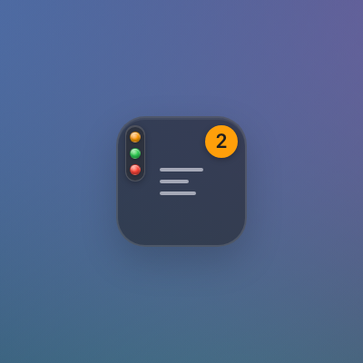
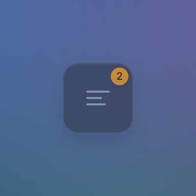
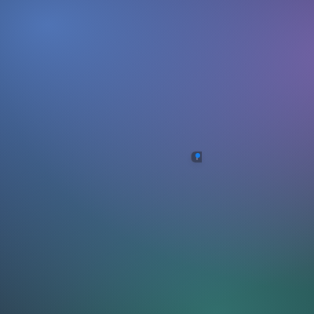

# Agent Monitor — AI coding agent session monitor

**Keep Codex, Claude Code, DeepSeek Harness, ZCode and Antigravity sessions in view on macOS and Windows.**

Agent Monitor brings your existing coding-agent sessions into a desktop pet,
system-tray panel and macOS Dynamic Island. See who is working, which session
needs an answer and what just finished, then click to return to its conversation
or host application. Supported macOS routes verify the selected conversation
before reporting a session-level jump.

**中文** · AI 编程助手会话监控工具，支持 OpenAI Codex、Claude Code、DeepSeek Harness（DSH）、ZCode 与 Google Antigravity。通过桌宠、菜单栏／系统托盘和 macOS 灵动岛查看多会话状态，定位待回答任务，并跳转回对应会话。

[Download the latest release](https://github.com/Hoemr/agent-monitor/releases/latest) ·
[v0.9.0 release notes](docs/releases/v0.9.0.md) ·
[Supported agents](#supported-agents-and-session-navigation) ·
[Project comparison](#related-projects-and-workflows)

## Download and get started

| Platform | Download | Requirements |
|---|---|---|
| macOS | [Apple silicon app](https://github.com/Hoemr/agent-monitor/releases/latest/download/Agent-Monitor-macos-arm64.zip) | macOS 14.5+, arm64 |
| Windows | [Installer](https://github.com/Hoemr/agent-monitor/releases/latest/download/Agent-Monitor-windows-x64-setup.exe) | Windows 10/11, x64. Can install WebView2. |
| Windows portable | [Portable ZIP](https://github.com/Hoemr/agent-monitor/releases/latest/download/Agent-Monitor-windows-x64.zip) | Windows 10/11, x64, existing WebView2 Runtime |

Download checksums accompany each release. macOS packages use a persistent local
signing certificate and require manual installation. They have not been
Apple-notarized. Windows packages use manual installation and may show an
unknown-publisher/SmartScreen prompt. [Installation details](docs/releases/v0.9.0.md).

1. Install and launch Agent Monitor alongside your coding tools. The default
   integrations read the session files and databases those tools already maintain.
2. Open **Settings → Monitor** to choose agents, history retention and the number
   of visible rows. Every retained session remains reachable by scrolling.
3. On macOS, enable **Settings → Desktop Pet → Dynamic Island**, or use the tray
   menu. Hover to expand, move away to collapse and click a row to jump.
4. Choose a capsule or animated mascot in **Settings → Desktop Pet**. The pet and
   island can appear together and share the same session state.
5. For macOS session navigation, use **Settings → Jump** to check Accessibility
   and Automation permissions. [Jump setup](docs/JUMP.md).

## What makes Agent Monitor useful

- **One view across five coding tools.** Keep OpenAI Codex, Claude Code,
  DeepSeek Harness, ZCode and Antigravity together, with explicit desktop,
  VSCode or Terminal host labels where available. DSH and ZCode have dedicated
  adapters for their local session records.
- **Return to a specific conversation on supported macOS routes.** Codex,
  Claude Code in VSCode, DSH and ZCode use route-specific confirmation. Rows
  expose the achievable jump level, and navigation reports what was confirmed.
- **A desktop pet and a compact Dynamic Island.** Animated pets reflect task
  activity. The macOS island uses native translucent material, identifies busy
  agents while collapsed and expands into two-line session cards. Both panels
  share language, colours, ordering and unread state.
- **Track the answer you still need to read.** A completion marker belongs to
  a particular completed turn. It clears when that version is acknowledged
  through a confirmed jump, an identified manual view or a read action. A later
  answer can light it again. Explicit pending questions have their own attention
  state and optional notifications.
- **Read existing local records.** Adapters use local transcripts and SQLite
  indexes. Start monitoring the sessions already on your machine. Pin and rename
  conversations in the pet panel, and use English or Chinese throughout the UI.

### Desktop pet states

| Status capsule | Waiting for your answer | Hidden at the screen edge |
|---|---|---|
|  |  |  |

## Related projects and workflows

The projects below overlap in agent monitoring and session management. This
table summarizes the workflows described in their own documentation, reviewed
on 2026-11-09.

| Project | Documented focus | Workflow to consider |
|---|---|---|
| **Agent Monitor** | Existing local sessions across Codex, Claude Code, DSH, ZCode and Antigravity, with a desktop pet, macOS island and graded navigation | Mixed desktop and VSCode workflows, including DSH and ZCode, with visible session state and verified macOS jumps |
| [Agent Island](https://agent-island.dev/) | Session status, usage quotas and report cards on macOS and Windows | Keeping agent activity and usage information together |
| [AgentBar](https://github.com/michalstrnadel/AgentBar) | Hook-driven agent status and permission actions through a macOS menu bar or notch interface | Answering agent permission requests from a persistent desktop surface |
| [Vibe Notch, formerly Claude Island](https://github.com/farouqaldori/vibe-notch) | Notch notifications, approvals and conversation history for Claude Code CLI sessions | A Claude Code CLI workflow centred on the MacBook notch |
| [Agent Deck](https://github.com/asheshgoplani/agent-deck) | Organizing and operating coding-agent sessions through a terminal UI and tmux | Launching, grouping and resuming agents from the terminal |

Agent Monitor's focus is **existing local sessions, DSH/ZCode integration,
verified navigation and a choice of desktop pet or island**. The integration
table below specifies the hosts and jump levels available in this release.

## Supported agents and session navigation

| Integration | Local session source | macOS navigation |
|---|---|---|
| **OpenAI Codex** desktop, VSCode and interactive CLI | Codex SQLite indexes, rollout JSONL and read receipts where available | L3 for verified desktop/VSCode conversations. Interactive CLI sessions focus Terminal at L1. |
| **Claude Code** in VSCode | Parent-turn transcript events under `~/.claude/projects` | L3 when the extension conversation is confirmed, otherwise the result identifies the achieved level. |
| **DeepSeek Harness / DSH** desktop | Session projections and compressed reply logs under `~/.dsh` | L3 through a matched, rendered sidebar row and window read-back. Requires Accessibility. |
| **ZCode** desktop | Live task index and transcript under `~/.zcode` | L3 through native task search and active conversation-heading verification. Requires a unique nonempty indexed title and Accessibility. |
| **Google Antigravity** desktop and CLI | Local SQLite summaries and per-conversation records under `~/.gemini` | L1 focus of Antigravity or Terminal, according to the session host. |

**L3** identifies a session or tab, **L2** a window, **L1** an application and
**L0** an unavailable target. Current Windows navigation focuses the host
application at L1. With several terminal windows, select the intended tab or
window yourself. [Windows support](docs/WINDOWS.md).

Completion tracking uses task lifecycle events, parent-turn endings and source
index evidence according to the integration. Unclear states are labelled
**Unknown**. Pinned conversations lead the list, followed by recent activity.
All retained sessions are accessible through scrolling. The capability matrix
records the evidence and conditions for each route. [Capability matrix](docs/CAPABILITIES.md).

### Session details

Rows show the title, agent, host, status, latest recorded model, relative activity
time, jump level and pin marker. The pet panel can show an activity summary.
The island keeps a two-line layout and offers summaries through the row tooltip
when the shared summary setting is enabled.

## Local data and privacy

Monitoring reads the agents' local files and SQLite databases. Agent Monitor
needs access to those records and uses operating-system permissions for supported
navigation routes. Session names, pins, ignored tasks and read state are stored
locally. Conversation content stays on the machine.

GitHub release checks and user-requested downloads are the application's network
update paths. The current v0.9.0 packages use manual downloads. Signing and updater
details are documented separately. [Update and signing guide](docs/UPDATING.md).

| Platform | Settings directory |
|---|---|
| macOS | `~/Library/Application Support/agent-monitor` |
| Windows | `%LOCALAPPDATA%\agent-monitor` |

Open Settings from the tray menu, the pet panel's gear button, **Cmd+,** on macOS
or **Ctrl+,** on Windows. Custom Codex account homes can be listed as absolute
paths in `codex-homes.json` in the settings directory. Include the platform's
normal Codex data directory if it should also be scanned, then restart the app.
[Settings reference](docs/SETTINGS.md).

## Build and verify

Agent Monitor uses **Tauri 2, Rust and vanilla JavaScript**. The frontend is
embedded in the application. macOS builds need Rust, Command Line Tools and
macOS 14.5+. Windows builds need the Rust MSVC toolchain, Visual Studio C++ Build
Tools, Node.js and WebView2. [Windows build guide](docs/WINDOWS.md).

### macOS

```sh
cargo test --locked --manifest-path src-tauri/Cargo.toml
cargo build --release --locked --manifest-path src-tauri/Cargo.toml
python3 scripts/ui-test.py

# Create the persistent local signing identity once, then package the app.
python3 scripts/sign-mac.py --setup
bash scripts/bundle-mac.sh
open "dist/Agent Monitor.app"
```

The UI checks use Chrome. Set the `CHROME` environment variable if its executable
is installed outside the default location.

### Windows

```powershell
cargo test --release --locked --manifest-path src-tauri/Cargo.toml
python scripts/ui-test.py
npx --yes @tauri-apps/cli@2.11.4 build --bundles nsis
```

### Headless adapter checks

```sh
src-tauri/target/release/agent-monitor --dump-agents
src-tauri/target/release/agent-monitor --dump-tasks
src-tauri/target/release/agent-monitor --jump-diagnostics
```

v0.9.0 passed **284 macOS Rust tests**, **285 Windows Rust tests** and **356
browser UI checks on each platform**. Each Rust suite skips one host-dependent
check. The Windows workflow also verifies NSIS packaging, native snapshot output
and desktop startup. macOS packaging includes archive and persistent-signature
verification. [Release verification](https://github.com/Hoemr/agent-monitor/releases/tag/v0.9.0),
[Windows CI](https://github.com/Hoemr/agent-monitor/actions/runs/42553998271).

## Documentation

| Topic | Guide |
|---|---|
| Agent data sources, states and verified navigation | [Capabilities](docs/CAPABILITIES.md) |
| Jump permissions, results and troubleshooting | [Session navigation](docs/JUMP.md) |
| Pending questions and notifications | [Attention alerts](docs/ATTENTION.md) |
| English/Chinese UI, history, rows and other controls | [Settings](docs/SETTINGS.md) |
| Animated mascots and custom artwork | [Pet system](docs/PETS.md), [Custom icons](docs/ICONS.md) |
| Adding another coding-agent adapter | [Adapter guide](docs/NEW_AGENT.md) |
| Layout and interaction contracts | [UI contract](docs/UI_CONTRACT.md) |
| Signing, release packages and updater internals | [Updates](docs/UPDATING.md) |
| Performance methodology and historical measurements | [Performance](docs/PERF.md) |
| Test scenarios and evidence | [Acceptance](docs/ACCEPTANCE.md) |

Release history is recorded in the notes for [v0.9.0](docs/releases/v0.9.0.md),
[v0.8.1](docs/releases/v0.8.1.md) and [v0.8.0](docs/releases/v0.8.0.md).

For a bug report, include the Agent Monitor version, operating system, agent and
host application, and the observed status or jump result.
[Open an issue](https://github.com/Hoemr/agent-monitor/issues).
