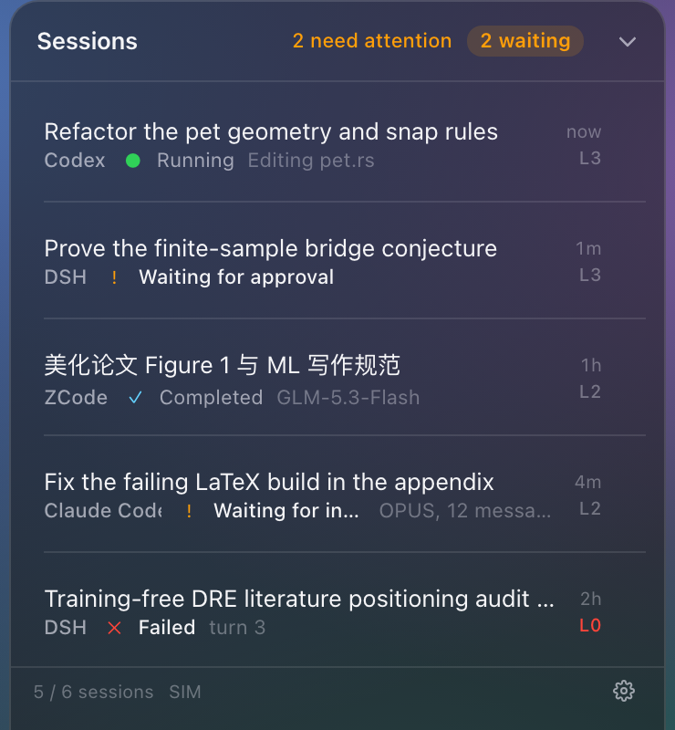
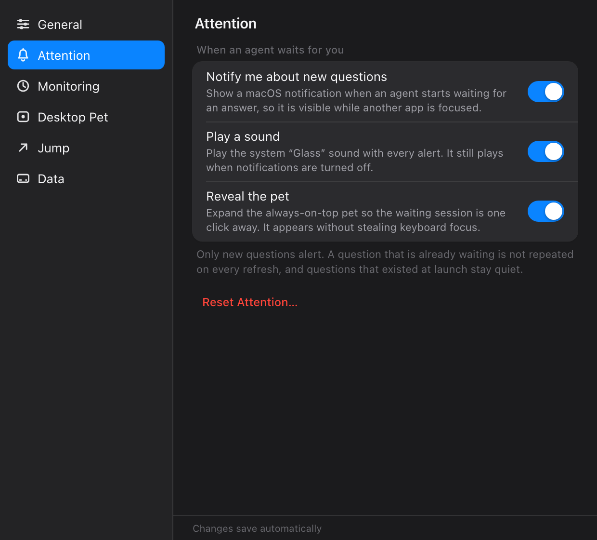
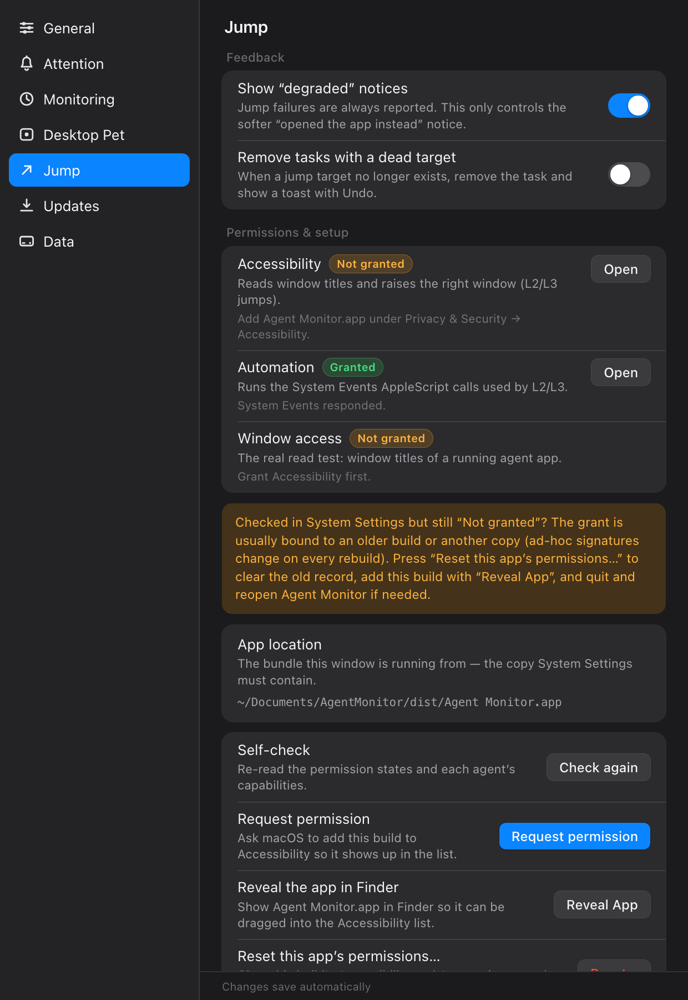
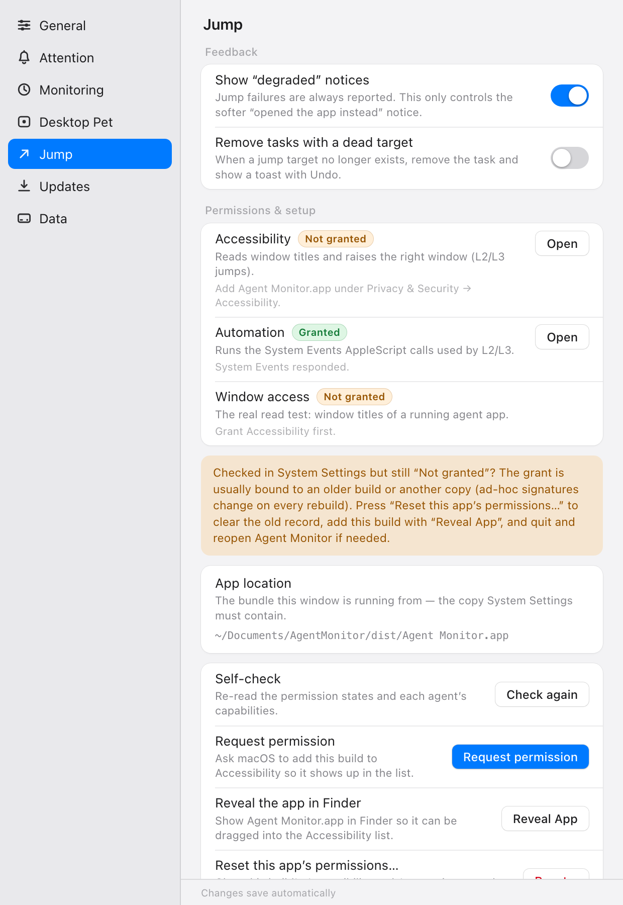
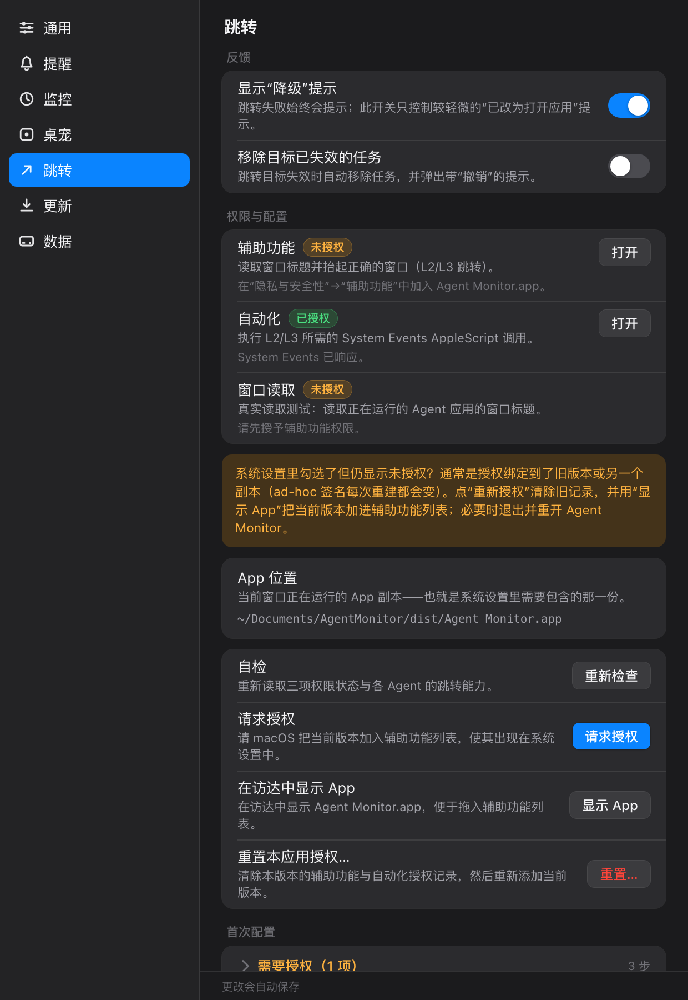
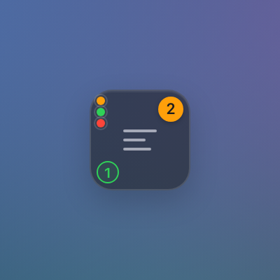
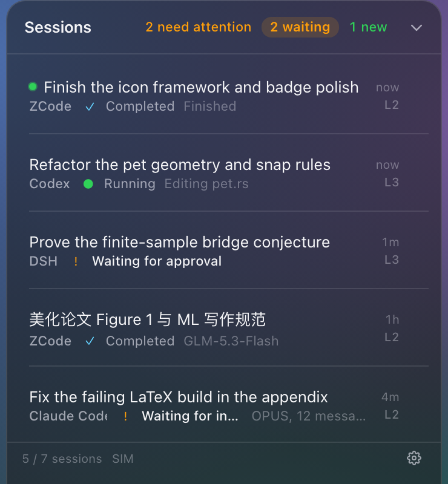
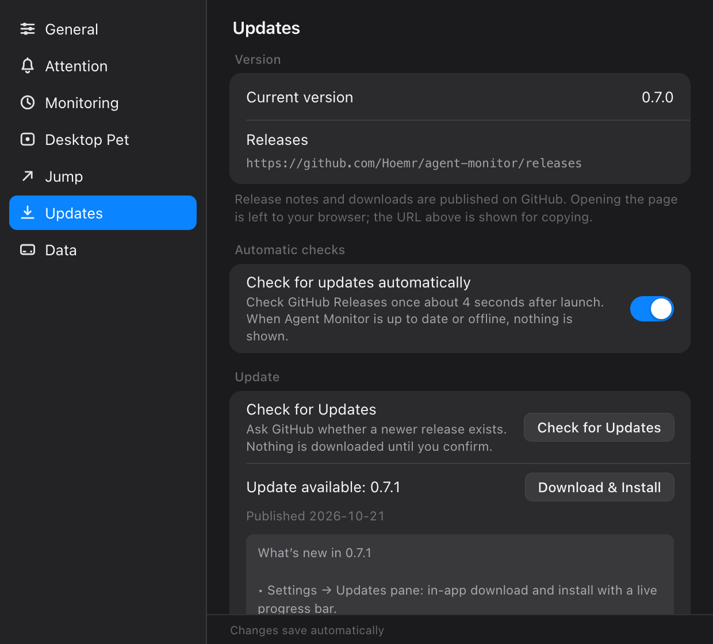
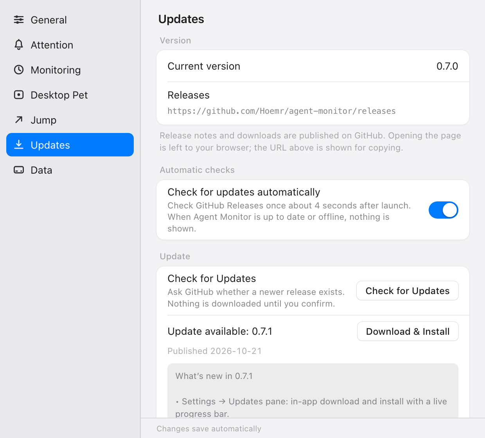
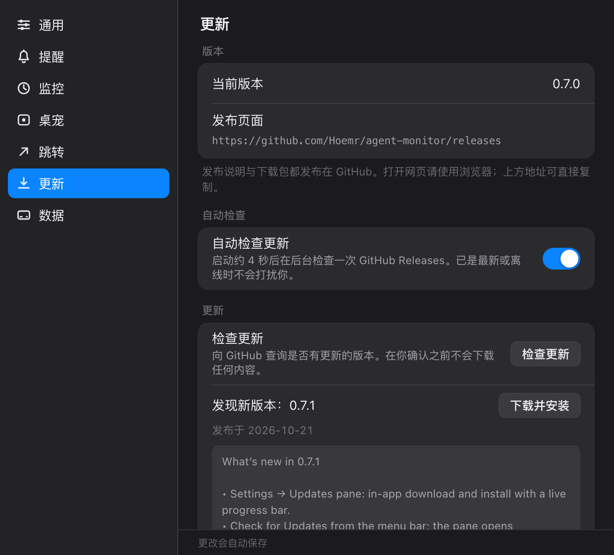

# Agent Monitor — desktop pet for multi-agent coding sessions

Version **0.8.1** adds a Windows 10/11 x64 build for native terminal and VSCode
sessions: [Windows setup and limitations](docs/WINDOWS.md). Download the
installer or portable ZIP from [GitHub Releases](https://github.com/Hoemr/agent-monitor/releases).
See the [v0.8.1 release notes](docs/releases/v0.8.1.md).

Version **0.8.0**: expressive pixel pets, Antigravity monitoring, pinned and
renamed conversations, and more reliable session status and jumps.
See the [release notes](docs/releases/v0.8.0.md).
The v0.8.0 download uses a persistent local signature and manual installation;
it is not Apple-notarized and does not offer in-app updates.

A small, quiet **menu-bar/tray-only** desktop pet (no Dock icon) that shows every
parallel coding-agent session in one place — pinned conversations first, then recent activity — and jumps to
the right window/session when you click a task.

Click the pencil beside a session title to give it a custom name. Names are
saved per session in `session-names.json` in the app data directory and survive
refreshes and restarts. Save an empty name to restore the source title; naming
does not change the source conversation or its jump target.

VSCode sessions show a `VSCode` label. Codex distinguishes extension sessions
from desktop sessions using the rollout originator and reads committed SQLite
WAL updates. Both VSCode integrations open the workspace and then the specified
chat through the extension URI. L3 requires an exact session identifier or the
unique source title in the focused chat webview; otherwise the result reports
window level only. VSCode may ask permission to open an extension URI. Claude
Code uses the first user prompt when no explicit title exists. The configured
history window is unchanged.

It is built to look like a native macOS popover: real **vibrancy material**
(NSVisualEffectView `popover`), SF system typography, semantic system colours,
hairline separators, and an interface that follows the system light/dark
appearance. No webfonts, no dashboard chrome.

On macOS, enable **Dynamic Island** in **Settings → Desktop Pet**, or from the
tray menu. The translucent menu-bar panel shows the active agent and sessions
waiting for attention. Hover to expand its compact two-line session rows,
scroll to reach every session, and click a row to jump. It shares the pet's
session order, status colours, language and display settings. Task summaries
are available in the row tooltip. The desktop pet can stay visible alongside it.

Built on the existing Agent Monitor project (Tauri 2 + Rust + vanilla JS) — the
monitoring core was refactored rather than replaced, the old Claude-Code-only
scanner was ported into a proper adapter, and the always-on widget became a
dockable, edge-snapping pet.

| Dark appearance | Light appearance |
|---|---|
|  |  |

*(Previews rendered from the shipped HTML/CSS with the labelled `SIM` fixture, over a desktop backdrop to show the translucent material.)*

### Collapsed / hidden states

| Collapsed: semantic status capsule | Collapsed: pending notice dot | Edge-hidden tab |
|---|---|---|
|  |  |  |

*(Solid blue = tasks waiting for you; top-left translucent capsule = macOS-style status beads: amber = a session is waiting on a question, green = new completions since you last opened, red = failed/interrupted — all can show at once; bottom-right small amber/red/blue dot = a jump notice is pending (the full message appears when the panel expands). The hidden state is a small square tab attached to the screen edge — the snapped side is off-screen, so only that nub shows.)*

### Settings window (Cmd+, · tray → Settings… · footer gear)

| Dark | Light |
|---|---|
|  |  |

Custom icon framework (Desktop Pet → Icon; see [`docs/ICONS.md`](docs/ICONS.md)):


Chinese UI (language setting updates the pet, this window and the menu bar):


### Pending questions, project-precise jump & setup

A session that **newly** blocks on a question turns the collapsed badge amber and
pulses it. Settings → Attention can additionally send a macOS notification, play
the Glass sound and auto-reveal the always-on-top panel without stealing keyboard
focus (see [`docs/ATTENTION.md`](docs/ATTENTION.md)).

| Collapsed: waiting-question badge | Expanded: “N waiting” chip |
|---|---|
|  |  |

Settings → Jump is now a setup page: live Accessibility / Automation / window-read
status, buttons that open the exact System Settings pane or reveal the app for the
Accessibility list, a self-check, the one-time signing migration note and a per-agent
capability table (see [`docs/JUMP.md`](docs/JUMP.md)).

| Attention alerts | Jump permissions & self-check |
|---|---|
|  |  |

Repairing a stale grant (collapsed guide, app location, Request permission /
Reset this app's permissions):





### New completions, status dots & in-app updates (0.7.0)

Unread completions carry a green dot until that task is opened by a confirmed jump or identified as the foreground conversation; opening
the panel does not mark any conversation read. While the pet is collapsed a
three-dot status cluster shows **yellow** (someone is waiting on a question),
**green** (new completions) and **red** (failed/interrupted sessions) at the same
time, with the jump-notice dot moved to the bottom-right corner.

| Collapsed: three status dots | Expanded: newly completed rows |
|---|---|
|  |  |

Settings → Updates (and tray → Check for Updates…) checks GitHub Releases,
downloads the signed `.app` tarball, verifies it and installs it in place, then
offers a restart — no reinstall ([`docs/UPDATING.md`](docs/UPDATING.md)).

| Updates (dark) | Updates (light) |
|---|---|
|  |  |



### Menu-bar icon


A proper macOS **template image** (72 px source, rendered as an 18 pt status item, tinted
automatically for light/dark menu bars): a three-session mark that matches the pet, and a
variant with a notification dot when a task needs you. Left click shows/collapses the pet;
right click opens the menu (localized from the Settings language; `System` follows macOS).
|  |  |

## Supported agents (real local data, no APIs assumed)

| Agent | Source | Multi-session | Highest verified jump |
|---|---|---|---|
| **Codex** (ChatGPT app + VSCode extension) | `~/.codex/state_5.sqlite` + rollout JSONL + `thread_history_1.sqlite` | thread id | **L3** `codex://threads/<id>` (verified) |
| **DSH** (DeepSeek Harness) | `~/.dsh/storages/session_projcache/sessions/*.json` | session dir | **L3** — sidebar session click via macOS AX (verified, needs Accessibility) |
| **ZCode** | `~/.zcode/v2/tasks-index.sqlite` + transcript | `task_id` | **macOS L3**: unique current title from indexed ID → native task search → active conversation H1 verification |
| **Claude Code** (`anthropic.claude-code` **VSCode extension**) | `~/.claude/projects/**/*.jsonl` parent-turn events | transcript UUID | **L3** — extension session URI with focused-chat verification; L2 if unconfirmed |

Full matrix with evidence and limitations: [`docs/CAPABILITIES.md`](docs/CAPABILITIES.md) ·
jump probes: [`docs/JUMP.md`](docs/JUMP.md) · acceptance: [`docs/ACCEPTANCE.md`](docs/ACCEPTANCE.md).

## Features

* One unified task list ordered by **most recent activity first** (running
  conversations naturally rise to the top; waiting tasks and *recent* failures
  are highlighted with a badge and accent, never by re-grouping the list): agent, title, unified
  status (running / waiting input / waiting approval / completed / failed / idle /
  unknown), real last-activity time, short summary, and the actual jump level
  (`L3`…`L0`).
* **Honest attention state**: waiting-for-input/approval always counts, failures
  only while recent (<30 min) and not deliberately interrupted/cancelled, so a
  turn you stopped long ago never keeps the badge or menu-bar alert alive.
* **Never miss a pending question**: when a session *newly* blocks on
  `ask user question` / approval, the pet pulses its amber question badge, sends
  a localised macOS notification, optionally plays the Glass sound and can
  auto-reveal the always-on-top panel **without stealing focus** — so the
  blocked session is one click away even with many windows open. Only new
  questions alert (repeats are deduplicated; old questions at launch stay
  quiet). See [`docs/ATTENTION.md`](docs/ATTENTION.md).
* **Jump with honest degradation**: session → window → app → nothing. A level is
  reported only after a read-back check; failures/degradations show a short toast
  with a “Grant permission” action when needed. An app-level-only jump at its
  declared maximum reports success instead of a permanent “degraded” toast.
* **Project/session-precise jump**: DSH sessions are selected directly in its
  sidebar (macOS AX row match on session title + project/cwd + relative time, then
  a verified synthetic click → L3); VSCode windows are focused by workspace with
  `code --reuse-window <path>`, then the extension URI selects the requested
  chat. Focused chat identity or a unique source title confirms L3; the project
  window alone confirms L2. The current window is checked first, so a session
  that is already visible opens without a click.
* **Jump setup & self-check in Settings → Jump**: live Accessibility /
  Automation / window-read status, one-click buttons to open the exact System
  Settings pane or reveal the app for dragging into Accessibility, a collapsible
  first-run guide, re-check, the running bundle path, and a per-agent capability
  table (max level, installed/running, session-route support). When System
  Settings shows a grant but the app still reports “Not granted” (ad-hoc
  rebuilds/another copy), the pane explains it and offers **Request permission**
  (native AX prompt) and an inline-confirmed **Reset this app's permissions**
  (this bundle only). It re-checks automatically when you return from System
  Settings. Headless equivalent: `--jump-diagnostics`. Details in
  [`docs/JUMP.md`](docs/JUMP.md).
* **Desktop pet**: drag anywhere, snap to the nearest screen edge, hide to a
  small square tab (8–24 px) whose snapped side is fully off-screen (or to the
  menu bar when edge-hiding is disabled), hover/click to expand inward, 3/5/8
  visible rows with scroll, quiet idle dot. The footer shows
  `visible / total` sessions (e.g. `5 / 119`) so the count matches what the
  window can display.
* **Pinned conversations**: use the pin beside a title to keep a conversation at
  the top, including after restart or beyond the ordinary retention window.
  Pinning and unpinning do not open the conversation or mark it read.
* **Latest model**: each row displays the full latest recorded model id. Missing
  evidence is labelled unknown; a planned future model is never presented as used.
  DSH sessions whose projection omits the used model read it from actual replies
  in `~/.dsh/sessions/*/*/session.v4.jsonl.zstd`; unchanged logs are cached.
* **New-completion indicator**: the expanded header counts unread completions.
  Each row keeps its green dot across panel opens and restarts until a successful
  jump or a precisely identified manual conversation view acknowledges it. A later completion of the same task lights
  it again (switchable with `new_badge`; there is no collapsed count ring).
* **macOS-style status capsule while collapsed**: a small translucent
  traffic-light capsule at the top-left holds **amber** (a session is waiting on
  a question, gently breathing), **green** (new completions since your last
  look) and **red** (failed/interrupted sessions) glass beads. All three can
  appear at once and each has an accessible label; the jump-feedback notice dot
  moved to the bottom-right corner so the two never collide.
* **Updates built in**: Settings → Updates (and tray → Check for Updates…) checks
  GitHub Releases, downloads the signed `.app` tarball, verifies its minisign
  signature, installs it in place and offers a restart — no reinstall, no manual
  download. Launch checks are automatic (switchable) and silent when up to date
  or offline. See [`docs/UPDATING.md`](docs/UPDATING.md).
* **Custom icon framework**: make a square PNG/JPEG/WebP (≤2 MB), upload it in
  Settings → Desktop Pet → Icon, and the collapsed pet / hidden tab use your
  artwork — built-in glyph remains the fallback. Spec and extension points:
  [`docs/ICONS.md`](docs/ICONS.md).
* **Rust pet engine (mascot mode)**: choose Nailoong, Doraemon, Ti Hun or the
  British blue cat, with artwork that reacts to running tasks, pending questions,
  completions and quiet time. State-image pets keep the same edge-snapping
  geometry as the capsule. Imported Shimeji-ee packs can roam, fall, and be
  dragged and thrown (validated in memory before installation). Architecture,
  supported subset and pack spec: [`docs/PETS.md`](docs/PETS.md).
  Clicking anywhere outside the expanded popover collapses it immediately (an
  explicit click focuses the panel; hover never steals focus).
  The collapsed/snapped pet size is adjustable (48–96 px) and it can hide itself
  after an idle delay once snapped (“hide after snapping”, off by default).
* **Native Settings window** (Cmd+, · menu-bar menu · footer gear): language
  (System/English/中文), appearance (System/Light/Dark), pending-question alerts
  (notification/sound/auto-reveal), monitoring refresh interval, retention,
  per-agent collection switches, visible rows, pet timing and snapping, jump
  setup + feedback, data/recovery actions. Everything saves
  instantly, applies without a restart and persists across launches —
  see [`docs/SETTINGS.md`](docs/SETTINGS.md).
* **Multi-display aware**: placement uses each screen's *visible frame* (menu bar +
  Dock excluded), restores by screen identity + relative position, and recovers
  when a screen disappears.
* **Tray-only**: accessory activation policy — no Dock icon, no app-switcher
  entry, even while the Settings window is open. Reliable recall: tray → Show Pet /
  Reset Position; a second launch also restores the pet. It never steals keyboard
  focus on launch, updates, or hover.
* **Native macOS look**: translucent popover material that follows system
  light/dark appearance; SF Pro / PingFang SC typography; one state dot per row
  plus a text label (never colour alone); title-first hierarchy; no uppercase
  labels, no card grids, no decorative gradients.
* **Low resource use**: event-driven file watching with a slow fallback tick; no
  per-task timers; no faster-than-30 s UI timer; identical snapshots are not
  re-rendered.
* **Local only**: reads local files/SQLite read-only — no account, no upload, no
  telemetry. The only outbound requests are the updater's GitHub Releases check
  (one silent HTTPS GET for `latest.json` ~4 s after launch when automatic checks
  are on, or when you click Check for Updates) and the signed tarball download
  you explicitly start; nothing else talks to the network. Titles stay short;
  conversation bodies are not stored.

## Settings

| Entry | Shortcut |
|---|---|
| Menu-bar menu → **Settings…** | — |
| Footer gear button in the expanded pet | — |
| Any Agent Monitor window focused | **Cmd+,** |

Settings live in `~/Library/Application Support/agent-monitor/settings.json`
(atomic writes, corrupt file → `settings.json.bak` + defaults), placement in
`pet.json`, ignored tasks in `dismissed.json`. These files stay on your Mac; there
is no account, telemetry or cloud sync (the only outbound request is the updater
check described above). Full key-by-key contract:
[`docs/SETTINGS.md`](docs/SETTINGS.md).

## Build and run

Codex account homes can be listed in
`~/Library/Application Support/agent-monitor/codex-homes.json` as a JSON array of
absolute directories. This is the complete list, including the default
`~/.codex` directory; restart after editing it. Without this file only the
default home is read. Each home retains its own database/rollout cache, and
duplicate thread IDs appear once. Interactive CLI sessions carry a Terminal
label and activate Terminal at L1 rather than opening a desktop Codex chat.

Antigravity desktop reads `~/.gemini/antigravity/conversation_summaries.db`;
Antigravity CLI (`agy`) reads the corresponding index under
`~/.gemini/antigravity-cli`. Both use read-only SQLite with live WAL support and
per-conversation final-response evidence; empty and child sessions are excluded.
The Antigravity switch controls both sources. Desktop and CLI conversations stay
separate, contribute to the same task panel/pet status, and target Antigravity or
Terminal respectively when clicked (L1; exact-session navigation is unverified).
Model labels come from the latest parent turn's recorded generator metadata;
new turns without model evidence show “Model unknown” until the record arrives.

Requirements: macOS 14.5+ (for `light-dark()` appearance support), Rust (stable), Command Line Tools. No Xcode project and
no Node build step are required.

```bash
# production build (frontend assets are embedded via tauri's custom-protocol)
cargo build --release --manifest-path src-tauri/Cargo.toml
src-tauri/target/release/agent-monitor          # run the pet

# verify adapters without opening a window
src-tauri/target/release/agent-monitor --dump-agents
src-tauri/target/release/agent-monitor --dump-tasks

# one real jump (prints the graded outcome)
src-tauri/target/release/agent-monitor --jump 'codex:<thread-id>'
```

### macOS .app bundle

```bash
python3 scripts/sign-mac.py --setup  # once: fixed local identity in login Keychain
bash scripts/bundle-mac.sh     # → dist/Agent Monitor.app (persistent signature, LSUIElement)
open "dist/Agent Monitor.app"
```

The first time you click a task, macOS may ask for **Automation** (to focus the
target window) and **Accessibility** (to raise a specific window). The app only
uses them on your click, explains the need in the toast, and links to the exact
System Settings pane. It never resets or forces permissions.

## Development

```bash
npm test          # cargo test (155 unit tests: model/monitor/attention/agents/pet/settings/icons/jump/ax/update)
npm run ui-test   # 237 headless UI checks (pet 136 + settings 101, real DOM events)
npm run perf      # 5 min × hidden / idle / expanded sampling of the release app
npm run jump-probe
```

Layout/design notes for the frontend contract: [`docs/UI_CONTRACT.md`](docs/UI_CONTRACT.md).
Adding an agent: [`docs/NEW_AGENT.md`](docs/NEW_AGENT.md) — one adapter file + one
registry line; no UI or monitor changes.
Custom artwork: [`docs/ICONS.md`](docs/ICONS.md) — image spec, upload flow, slots
and how to add a new slot. In-app updates: [`docs/UPDATING.md`](docs/UPDATING.md) —
signing keys, CI secrets, release assets and local verification.

Extension acceptance uses the clearly-labelled synthetic adapter:

```bash
AGENT_MONITOR_SIMULATED=1 src-tauri/target/release/agent-monitor --dump-tasks
```

## Known limitations

* Codex shows an AI-generated window title while its database stores the first
  prompt, so Codex uses navigation evidence for L3 and cannot do exact-title L2.
* DSH is a single-window Electron app: it has no session URL, so session selection
  is done by clicking the sidebar row through the macOS AX API (requires
  Accessibility). Electron's AX tree only exposes rendered sidebar rows, so a
  session that is far outside the virtualized list degrades to app focus instead
  of guessing; duplicate titles are resolved with project + relative-time evidence
  and are reported as ambiguous rather than clicking the wrong session.
* VSCode project focusing uses the `code` CLI when installed (PATH, Homebrew,
  `/usr/local/bin`); without it the app falls back to `open -b com.microsoft.VSCode
  <workspace>` and then AX window matching.
* Updates are **full-artifact in-app updates** (like cc-switch), not binary
  deltas: the normal ~9 MB `.app` tarball is downloaded and swapped in place.
  An old ad-hoc bundle or a change of signing identity can invalidate the
  Accessibility/Automation grant; System Settings may still show the old
  checkbox. Settings → Jump shows the live status, auto-refreshes on return and
  offers **Request permission** plus a **Reset this app's permissions** action to
  repair stale records.
* **Never run `tccutil reset Accessibility` without a bundle id** — it clears the
  machine-wide Accessibility grants of every app, and only the user can restore
  them in System Settings. The in-app reset is hard-restricted to
  `com.agent.monitor`.
* The GitHub Release must be **published** (not a draft/prerelease) and carry
  `latest.json` + the signed macOS tarball; until a newer release exists the
  updater correctly reports "up to date". CI needs
  `TAURI_SIGNING_PRIVATE_KEY` — see [`docs/UPDATING.md`](docs/UPDATING.md).
* ZCode session jumps require unique nonempty titles in its live index and
  Accessibility permission. Ambiguous or unconfirmed selections report a clear
  result instead of navigating to an arbitrary workspace.
* Claude Code is treated as the **VSCode extension host** only (per project scope);
  terminal-hosted Claude sessions are not routed to Terminal.
* Physical multi-display, Space/full-screen, and first-run TCC prompts were **not
  executed** on this single-display host; see `docs/ACCEPTANCE.md` for repro steps.
* Performance numbers are measured on the test Mac in `docs/PERF.md` — budget
  figures there are observations, not platform guarantees.
* Settings P1 items (click-through in collapsed state, tint strength, launch at
  login, global shortcut, diagnostic export) are intentionally **not** in this
  release; reasons and the safe follow-up path are listed in `docs/SETTINGS.md`.
* Local bundles use a persistent certificate stored in the login Keychain.
  Moving from the old ad-hoc build requires one new permission grant. Subsequent
  builds keep the same certificate and bundle identifier. Do not delete the key
  or replace the bundle with a differently signed download. Local builds block
  online replacement; rebuild them locally instead. See `docs/UPDATING.md`.
* `retention_hours` now applies uniformly: completing an IDE-hosted Claude Code
  session older than the configured window (default 6 h, previously fixed 24 h
  for IDE sessions) hides it, and ZCode no longer keeps the newest three rows
  regardless of age — its ended sessions follow `retention_hours` too.
* `--dump-tasks` / `--dump-agents` honour `settings.json` (agent switches and
  retention) but do not hide dismissed tasks, so they can differ from the GUI
  for tasks you explicitly dismissed.
