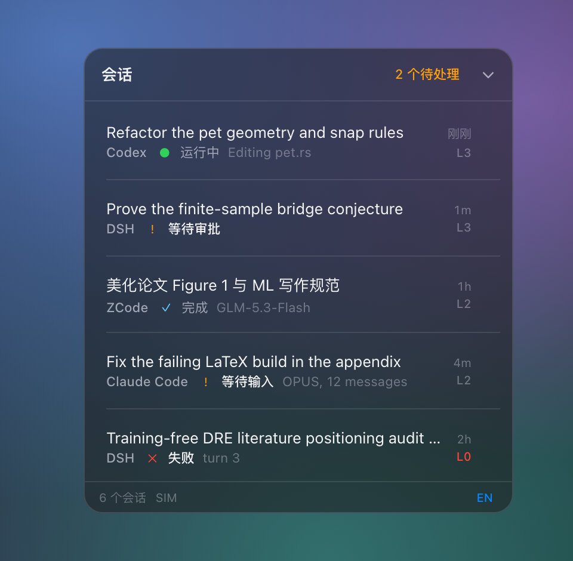
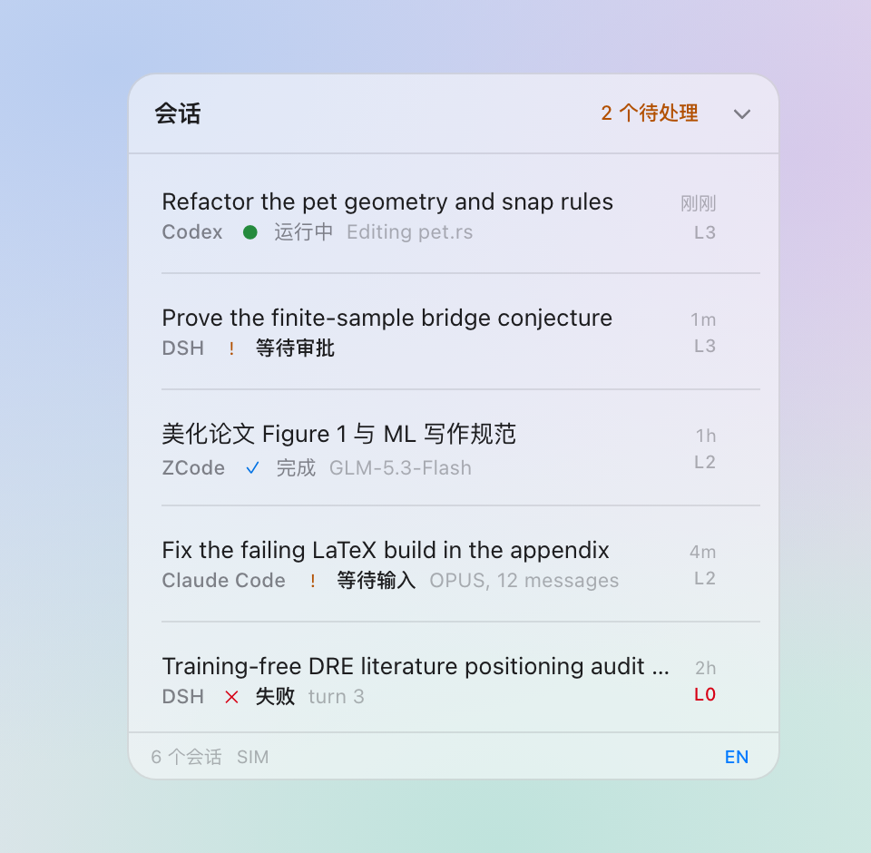
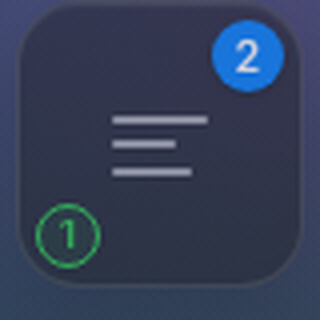
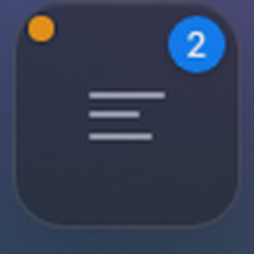
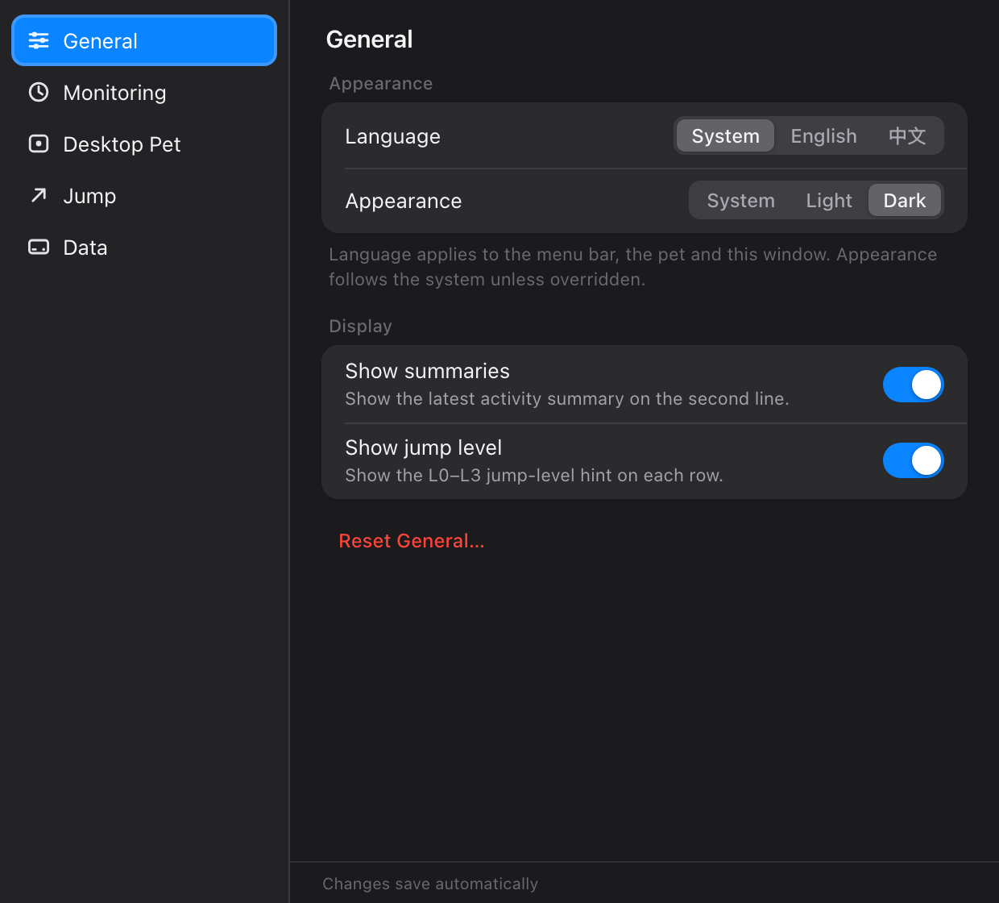
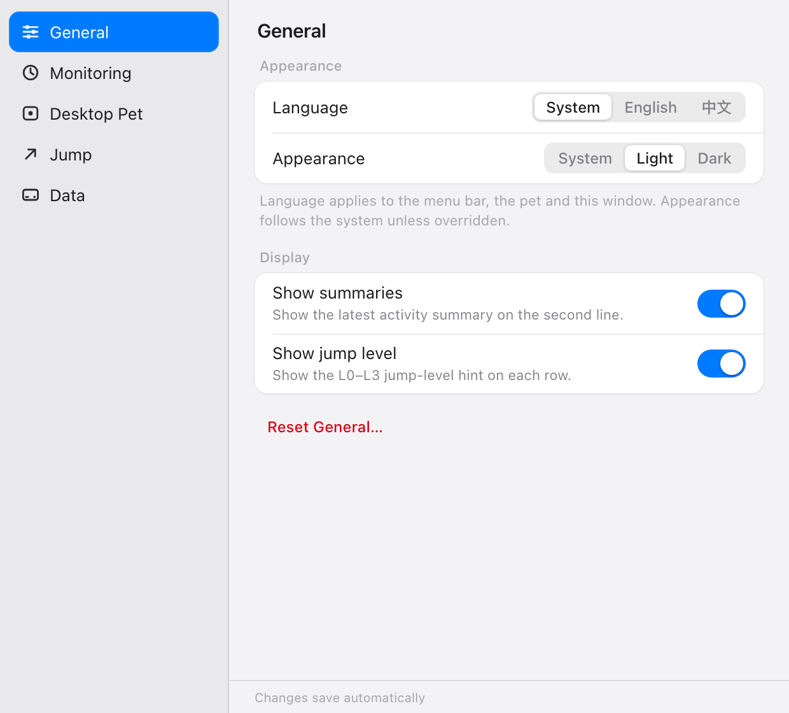
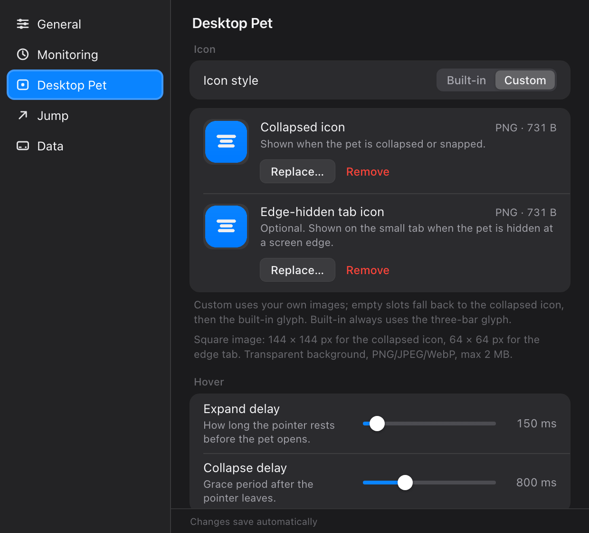
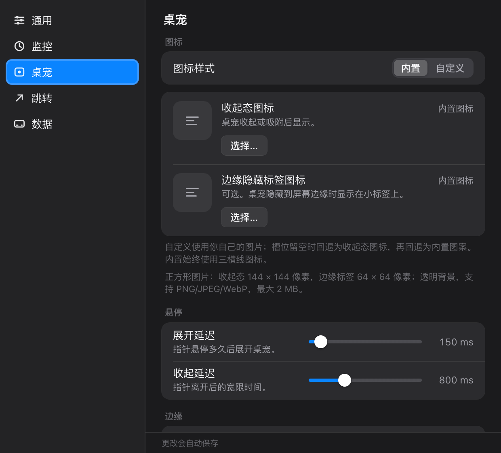
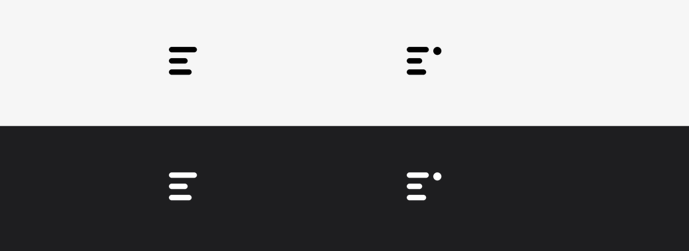

# Agent Monitor — desktop pet for multi-agent coding sessions (macOS)

A small, quiet **menu-bar/tray-only** desktop pet (no Dock icon) that shows every
parallel coding-agent session in one place — newest activity first — and jumps to
the right window/session when you click a task.

It is built to look like a native macOS popover: real **vibrancy material**
(NSVisualEffectView `popover`), SF system typography, semantic system colours,
hairline separators, and an interface that follows the system light/dark
appearance. No webfonts, no dashboard chrome.

Built on the existing Agent Monitor project (Tauri 2 + Rust + vanilla JS) — the
monitoring core was refactored rather than replaced, the old Claude-Code-only
scanner was ported into a proper adapter, and the always-on widget became a
dockable, edge-snapping pet.

| Dark appearance | Light appearance |
|---|---|
|  |  |

*(Previews rendered from the shipped HTML/CSS with the labelled `SIM` fixture, over a desktop backdrop to show the translucent material.)*

### Collapsed / hidden states

| Collapsed: attention + new-completion ring | Collapsed: pending notice dot | Edge-hidden tab |
|---|---|---|
|  |  |  |

*(Solid blue = tasks waiting for you; unfilled green ring = tasks completed since you last opened the panel; small amber/red dot top-left = a jump notice is pending (the full message appears when the panel expands). The hidden state is a small square tab attached to the screen edge — the snapped side is off-screen, so only that nub shows.)*

### Settings window (Cmd+, · tray → Settings… · footer gear)

| Dark | Light |
|---|---|
|  |  |

Custom icon framework (Desktop Pet → Icon; see [`docs/ICONS.md`](docs/ICONS.md)):



Chinese UI (language setting updates the pet, this window and the menu bar):



### Menu-bar icon



A proper macOS **template image** (72 px source, rendered as an 18 pt status item, tinted
automatically for light/dark menu bars): a three-session mark that matches the pet, and a
variant with a notification dot when a task needs you. Left click shows/collapses the pet;
right click opens the menu (localized from the Settings language; `System` follows macOS).
|  |  |

## Supported agents (real local data, no APIs assumed)

| Agent | Source | Multi-session | Highest verified jump |
|---|---|---|---|
| **Codex** (ChatGPT app + VSCode extension) | `~/.codex/state_5.sqlite` + rollout JSONL + `thread_history_1.sqlite` | thread id | **L3** `codex://threads/<id>` (verified) |
| **DSH** (DeepSeek Harness) | `~/.dsh/storages/session_projcache/sessions/*.json` | session dir | **L1** (host has no session URL — documented) |
| **ZCode** | `~/.zcode/v2/tasks-index.sqlite` | `task_id` | **blocked** on this host (`ZCode.app` exits immediately); data/mapping implemented |
| **Claude Code** (`anthropic.claude-code` **VSCode extension**) | `~/.claude/projects/**/*.jsonl`, `file-history/`, `ide/*.lock` | transcript UUID | **L2** VSCode window (verified) |

Full matrix with evidence and limitations: [`docs/CAPABILITIES.md`](docs/CAPABILITIES.md) ·
jump probes: [`docs/JUMP.md`](docs/JUMP.md) · acceptance: [`docs/ACCEPTANCE.md`](docs/ACCEPTANCE.md).

## Features

* One unified task list ordered by **most recent activity first** (running
  conversations naturally rise to the top; waiting tasks and *recent* failures
  are highlighted with a badge and accent, never by re-grouping the list): agent, title, unified
  status (running / waiting input / waiting approval / completed / failed / idle /
  unknown), real last-activity time, short summary, and the actual jump level
  (`L3`…`L0`).
* **Honest attention state**: waiting-for-input/approval always counts, failures
  only while recent (<30 min) and not deliberately interrupted/cancelled, so a
  turn you stopped long ago never keeps the badge or menu-bar alert alive.
* **Jump with honest degradation**: session → window → app → nothing. A level is
  reported only after a read-back check; failures/degradations show a short toast
  with a “Grant permission” action when needed.
* **Desktop pet**: drag anywhere, snap to the nearest screen edge, hide to a
  small square tab (8–24 px) whose snapped side is fully off-screen (or to the
  menu bar when edge-hiding is disabled), hover/click to expand inward, 3/5/8
  visible rows with scroll, quiet idle dot.
* **New-completion indicator**: while collapsed/hidden, an unfilled green ring
  (and the expanded header chip) shows how many tasks completed since you last
  looked at the panel — switchable with `new_badge`. A pending jump notice shows
  as a small text-free dot while collapsed and expands into the full toast.
* **Custom icon framework**: make a square PNG/JPEG/WebP (≤2 MB), upload it in
  Settings → Desktop Pet → Icon, and the collapsed pet / hidden tab use your
  artwork — built-in glyph remains the fallback. Spec and extension points:
  [`docs/ICONS.md`](docs/ICONS.md).
  Clicking anywhere outside the expanded popover collapses it immediately (an
  explicit click focuses the panel; hover never steals focus).
  The collapsed/snapped pet size is adjustable (48–96 px) and it can hide itself
  after an idle delay once snapped (“hide after snapping”, off by default).
* **Native Settings window** (Cmd+, · menu-bar menu · footer gear): language
  (System/English/中文), appearance (System/Light/Dark), monitoring refresh
  interval, retention, per-agent collection switches, visible rows, pet timing
  and snapping, jump feedback, data/recovery actions. Everything saves
  instantly, applies without a restart and persists across launches —
  see [`docs/SETTINGS.md`](docs/SETTINGS.md).
* **Multi-display aware**: placement uses each screen's *visible frame* (menu bar +
  Dock excluded), restores by screen identity + relative position, and recovers
  when a screen disappears.
* **Tray-only**: accessory activation policy — no Dock icon, no app-switcher
  entry, even while the Settings window is open. Reliable recall: tray → Show Pet /
  Reset Position; a second launch also restores the pet. It never steals keyboard
  focus on launch, updates, or hover.
* **Native macOS look**: translucent popover material that follows system
  light/dark appearance; SF Pro / PingFang SC typography; one state dot per row
  plus a text label (never colour alone); title-first hierarchy; no uppercase
  labels, no card grids, no decorative gradients.
* **Low resource use**: event-driven file watching with a slow fallback tick; no
  per-task timers; no faster-than-30 s UI timer; identical snapshots are not
  re-rendered.
* **Local only**: reads local files/SQLite read-only. No upload, no telemetry, no
  network calls. Titles stay short; conversation bodies are not stored.

## Settings

| Entry | Shortcut |
|---|---|
| Menu-bar menu → **Settings…** | — |
| Footer gear button in the expanded pet | — |
| Any Agent Monitor window focused | **Cmd+,** |

Settings live in `~/Library/Application Support/agent-monitor/settings.json`
(atomic writes, corrupt file → `settings.json.bak` + defaults), placement in
`pet.json`, ignored tasks in `dismissed.json`. Nothing leaves the machine; there
is no account, telemetry or cloud sync. Full key-by-key contract:
[`docs/SETTINGS.md`](docs/SETTINGS.md).

## Build and run

Requirements: macOS 14.5+ (for `light-dark()` appearance support), Rust (stable), Command Line Tools. No Xcode project and
no Node build step are required.

```bash
# production build (frontend assets are embedded via tauri's custom-protocol)
cargo build --release --manifest-path src-tauri/Cargo.toml
src-tauri/target/release/agent-monitor          # run the pet

# verify adapters without opening a window
src-tauri/target/release/agent-monitor --dump-agents
src-tauri/target/release/agent-monitor --dump-tasks

# one real jump (prints the graded outcome)
src-tauri/target/release/agent-monitor --jump 'codex:<thread-id>'
```

### macOS .app bundle

```bash
bash scripts/bundle-mac.sh     # → dist/Agent Monitor.app (ad-hoc signed, LSUIElement)
open "dist/Agent Monitor.app"
```

The first time you click a task, macOS may ask for **Automation** (to focus the
target window) and **Accessibility** (to raise a specific window). The app only
uses them on your click, explains the need in the toast, and links to the exact
System Settings pane. It never resets or forces permissions.

## Development

```bash
npm test          # cargo test (88 unit tests: model/monitor/agents/pet/settings/icons)
npm run ui-test   # 114 headless UI checks (pet 69 + settings 45, real DOM events)
npm run perf      # 5 min × hidden / idle / expanded sampling of the release app
npm run jump-probe
```

Layout/design notes for the frontend contract: [`docs/UI_CONTRACT.md`](docs/UI_CONTRACT.md).
Adding an agent: [`docs/NEW_AGENT.md`](docs/NEW_AGENT.md) — one adapter file + one
registry line; no UI or monitor changes.
Custom artwork: [`docs/ICONS.md`](docs/ICONS.md) — image spec, upload flow, slots
and how to add a new slot.

Extension acceptance uses the clearly-labelled synthetic adapter:

```bash
AGENT_MONITOR_SIMULATED=1 src-tauri/target/release/agent-monitor --dump-tasks
```

## Known limitations

* Codex shows an AI-generated window title while its database stores the first
  prompt, so Codex uses navigation evidence for L3 and cannot do exact-title L2.
* DSH is a single-window Electron app whose only deep link is `dsh://open` (focus),
  so session-level jumping is impossible and is reported as L1.
* `ZCode.app` (Electron 41) exits immediately on the test host (macOS 27 beta);
  its data is shown, its jump is reported as unconfirmed. Details in `docs/JUMP.md`.
* Claude Code is treated as the **VSCode extension host** only (per project scope);
  terminal-hosted Claude sessions are not routed to Terminal.
* Physical multi-display, Space/full-screen, and first-run TCC prompts were **not
  executed** on this single-display host; see `docs/ACCEPTANCE.md` for repro steps.
* Performance numbers are measured on the test Mac in `docs/PERF.md` — budget
  figures there are observations, not platform guarantees.
* Settings P1 items (click-through in collapsed state, tint strength, launch at
  login, global shortcut, diagnostic export) are intentionally **not** in this
  release; reasons and the safe follow-up path are listed in `docs/SETTINGS.md`.
* `retention_hours` now applies uniformly: completing an IDE-hosted Claude Code
  session older than the configured window (default 6 h, previously fixed 24 h
  for IDE sessions) hides it; ZCode's newest-3 fallback is unchanged.
* `--dump-tasks` / `--dump-agents` honour `settings.json` (agent switches and
  retention) but do not hide dismissed tasks, so they can differ from the GUI
  for tasks you explicitly dismissed.
